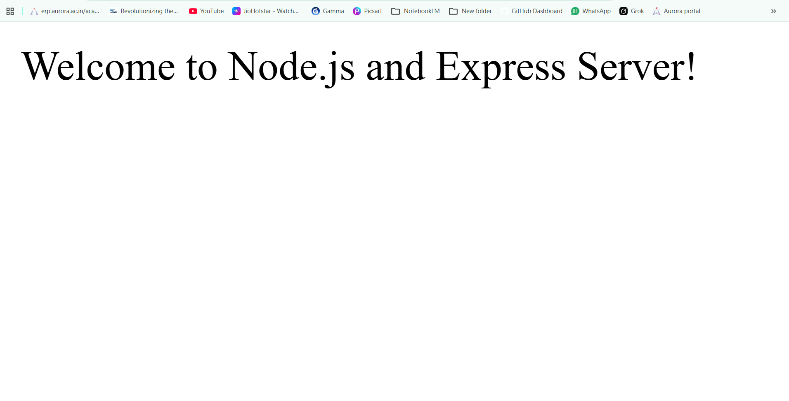
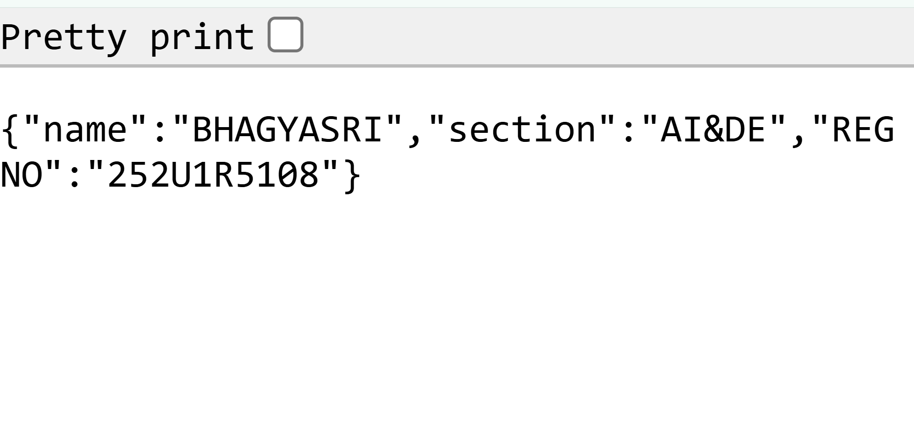
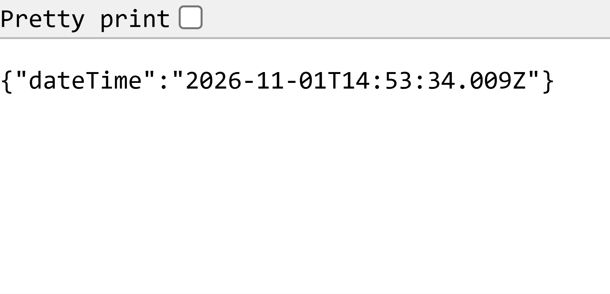
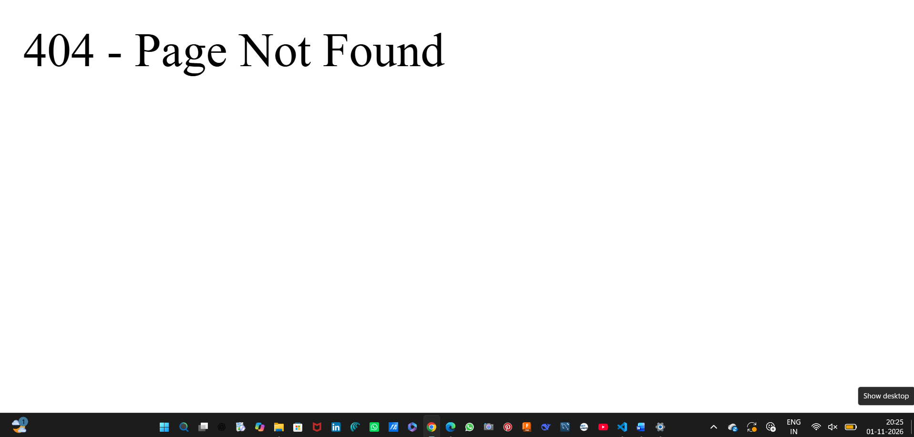

# Lab 1 – Node.js and Express Server

## Student details

- **Name:** [Enter Your Name]
- **Registration number:** [Enter Registration Number]
- **Section:** [Enter Section]
- **Subject:** Backend Development Fundamentals
- **Faculty:** Joel Prashanth D.

## Project objective

Build and run a basic HTTP server with Node.js, then create an Express server with routes for a welcome message, student details, the current date and time, and a not-found response.

## Technologies used

- Node.js and its built-in `http` module
- Express.js
- npm (Node Package Manager)

## Project structure

```text
lab-01/
├── package.json
├── package-lock.json
├── server.js
├── basic-server.js
├── .gitignore
├── README.md
└── screenshots/
    ├── home.png
    ├── about.png
    ├── time.png
    └── not-found.png
```

The screenshot files are captured browser outputs for the project routes.

## Project files and npm

- **`package.json`** describes the project and its npm configuration:
  - `name`: unique package/project name (`lab-01-node-express-server`).
  - `version`: project version, starting at `1.0.0`.
  - `description`: short summary of the project.
  - `main`: the main project file, set here to `server.js`.
  - `scripts`: named commands; `npm start` starts Express and `npm run start:basic` starts the built-in HTTP example.
  - `keywords`: searchable terms describing the project.
  - `author`: the student name placeholder; replace it with your name.
  - `license`: the package license identifier (`ISC`).
- **`package-lock.json`** is generated by npm. It records the exact installed dependency versions and their dependency tree so installs can be reproduced.
- **`node_modules/`** is created by npm when installing packages. It contains Express and the packages Express depends on. Do not create it manually or commit it to Git; `npm install` recreates it from the package files.
- **`server.js`** contains the Express application and its four routes.
- **`basic-server.js`** demonstrates a plain HTTP server using Node.js without Express.
- **`.gitignore`** prevents `node_modules/`, `.env`, and `.DS_Store` from being tracked by Git.
- **`screenshots/`** is where you save screenshots after testing the routes in a browser.

## Install and run

1. Open this `lab-01` folder in VS Code.
2. Open the integrated terminal with **Terminal > New Terminal** (or press **Ctrl+`**).
3. Make sure the terminal is in the `lab-01` directory. If needed, change to it with `cd path\to\lab-01`.
4. Install the project dependencies:

   ```bash
   npm install
   ```

5. Start the Express server:

   ```bash
   node server.js
   ```

   Or use the npm script: `npm start`. The terminal should display that the Express server is running at `http://localhost:3000` (unless the hosting environment provides a different `PORT`).
6. Open each address below in Google Chrome. Keep the terminal running while you test. Stop the server with **Ctrl+C** when finished.

To try the built-in HTTP example instead, stop the Express server first, then run `node basic-server.js` and visit `http://localhost:3000/`. It responds with `Hello`. Only one server can use the same port at a time.

## Endpoints and expected results

| HTTP method | Path | Description / expected output | Status code |
|---|---|---|---:|
| GET | `/` | `Welcome to Node.js and Express Server!` | 200 |
| GET | `/about` | JSON with `name` and `section`; replace the placeholders in `server.js` with your details. | 200 |
| GET | `/time` | JSON containing the current date and time in the `dateTime` field. | 200 |
| GET | Any unknown path, such as `/invalid` | `404 - Page Not Found` | 404 |

Test these URLs in Chrome:

- [http://localhost:3000/](http://localhost:3000/)
- [http://localhost:3000/about](http://localhost:3000/about)
- [http://localhost:3000/time](http://localhost:3000/time)
- [http://localhost:3000/invalid](http://localhost:3000/invalid)

Chrome displays the response body. To see the HTTP status code, open Developer Tools (**F12**) and check the **Network** tab while reloading a URL.

## Screenshots

The screenshots below show the browser output captured for each route.

### Home


### About


### Time


### Not found


## Problems faced and solutions

- **The port is already in use:** Stop the other server with **Ctrl+C** before starting this one. Do not run both examples on port 3000 at the same time.
- **Express cannot be found:** Run `npm install` from inside `lab-01` to install dependencies.
- **A route returns 404:** Check the URL spelling and confirm that the matching route is defined before the final 404 handler.

## Learning outcomes

- Understand the role of Node.js and npm in a backend project.
- Create an HTTP server with Node.js's built-in `http` module.
- Create Express routes and send text and JSON responses.
- Use HTTP status codes, including 200 and 404.
- Install dependencies and run a server locally.

## GitHub preparation

Because the repository will contain multiple labs, run Git commands from the **parent repository folder** (the folder containing `lab-01/`), not from inside `lab-01/`. Replace the example remote URL with your own GitHub repository URL. If Git has already been initialized in the parent folder, do not initialize it again.

```bash
git init
git add lab-01/
git commit -m "Add Lab 1 Node.js and Express server"
git branch -M main
git remote add origin https://github.com/YOUR-USERNAME/YOUR-REPOSITORY.git
git push -u origin main
```

If an `origin` remote is already configured, skip `git remote add origin ...`; use `git remote set-url origin https://github.com/YOUR-USERNAME/YOUR-REPOSITORY.git` only if you need to change its URL. The `.gitignore` keeps `node_modules/` and `.env` out of commits.

## Live deployment

This project is prepared for deployment on Render, Railway, or another supported Node.js hosting platform. The Express server listens on `process.env.PORT || 3000`, allowing the platform to provide its required port. Configure the platform to install dependencies with `npm install` and start the app with `npm start`. Deploy the project from the `lab-01/` directory (or configure that as the service's root directory in a multi-lab repository). No live deployment URL has been created.
